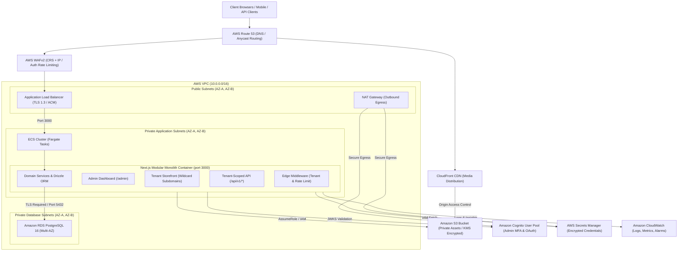

# Architecture Overview: Tenant-Aware Modular Monolith

## 1. Executive Summary

The **BeYourOwnBoss (BYOB)** platform is engineered as a high-concurrency, multi-tenant e-commerce website builder and commerce engine. It bridges ease-of-use (drag-and-drop visual store builder, immediate publishing) with enterprise-grade operational discipline: strict per-tenant data isolation, tenant-scoped database transactions, integer-minor-unit monetary calculations, defense-in-depth security, and cloud-native infrastructure automation.

### Architecture Tenets
- **Modular Monolith**: Core business domains (Tenants, Stores, Catalog, Orders, Media, Content, Analytics, Audit) are separated into strict module boundaries with dedicated domain services, repository layers, and schemas while running within a single optimized Next.js App Router runtime on AWS ECS Fargate.
- **Tenant Isolation in Every Query**: Zero ambient or global database state. Every single read, write, update, and delete query requires an explicit `tenantId`.
- **Zero Client-Supplied Trust**: Tenant identifiers extracted from host headers and subdomains are cryptographically and contextually verified against database registry records; client-provided body parameters claiming a tenant ID are categorically rejected or ignored.
- **Edge Routing & Ingress Defense**: Next.js Edge Middleware and AWS WAF inspect incoming requests, enforce distributed rate limiting, tag distributed correlation IDs (`x-correlation-id`), and isolate administrative vs. storefront execution paths.

---

## 2. Component Map



---

## 3. Network Topology & Security Perimeter

| Layer | Subnet Type | CIDR Range | Security Ingress / Egress | Hosted Components |
| :--- | :--- | :--- | :--- | :--- |
| **Edge & CDN** | Edge Network | Public Internet | HTTPS (443) from global users | AWS Route 53, CloudFront CDN, AWS WAFv2 Web ACL |
| **Ingress Tier** | Public Subnets | `10.0.1.0/24`<br>`10.0.2.0/24` | Ingress: 80 (HTTP to HTTPS redirect), 443 (TLS from WAF)<br>Egress: To ECS Security Group on 3000 | Internet Gateway, Dual-AZ Application Load Balancers, NAT Gateway |
| **Compute Tier** | Private App Subnets | `10.0.11.0/24`<br>`10.0.12.0/24` | Ingress: Port 3000 strictly from ALB SG<br>Egress: Outbound via NAT GW, Port 5432 to RDS SG, VPC endpoints | ECS Fargate Tasks (non-root `nextjs:1001`), Next.js App Router |
| **Data Tier** | Private DB Subnets | `10.0.21.0/24`<br>`10.0.22.0/24` | Ingress: Port 5432 strictly from ECS Task SG<br>Egress: None (isolated) | Amazon RDS PostgreSQL 16 Multi-AZ, automated daily snapshots, gp3 KMS encryption |

---

## 4. Multi-Tenancy Isolation Strategy

### 4.1 Ingress Resolution
Tenant resolution executes in [`src/middleware.ts`](../src/middleware.ts):
1. **Subdomain Extraction**: Resolves `x-tenant-slug` from request host headers (e.g., `acme.byoboss.io` extracts `acme`).
2. **Custom Domain Lookup**: For vanity storefront domains (e.g., `shop.acme.com`), queries tenant store registry.
3. **Admin Segregation**: Administrative host requests (`admin.byoboss.io`) route to the admin authentication and console context.
4. **Header Injection**: Mutated headers inject `x-tenant-slug` and `x-correlation-id` into downstream request context.

### 4.2 Application Runtime Scoping
Every domain repository adheres to strict tenant isolation:
- Database sessions inject the verified `tenantId`.
- Queries are constructed using Drizzle ORM helper builders that apply `eq(table.tenantId, tenantId)` across every `where` clause.
- Mutation methods check existing ownership prior to updating or deleting records:
  ```typescript
  // Canonical repository pattern
  export async function getProductById(tenantId: string, productId: string) {
    return await db.query.products.findFirst({
      where: and(
        eq(products.tenantId, tenantId),
        eq(products.id, productId)
      ),
    });
  }
  ```

### 4.3 Database Row-Level Security (RLS) Defence-in-Depth
In addition to application repository scoping, PostgreSQL tables define Row-Level Security policies:
- Tables contain a `tenant_id` foreign key referencing the `tenants` table.
- Composite indexes with `tenant_id` as the leading column optimize index scans:
  - `idx_orders_tenant_created (tenant_id, created_at)`
  - `idx_products_tenant_slug (tenant_id, slug)`
  - `idx_analytics_tenant_occurred (tenant_id, occurred_at)`

---

## 5. Data Flow Lifecycle

### 5.1 Storefront Read Request (e.g., Product Catalog)
1. **Visitor** sends `GET /products/wireless-headphones` to `store1.byoboss.io`.
2. **Route 53 & ALB** pass request through **AWS WAFv2** inspection (rate checks, CRS SQLi/XSS checks).
3. **Next.js Middleware** extracts tenant slug `store1` and sets `x-tenant-slug: store1` and `x-correlation-id: <ulid>`.
4. **Server Component** loads tenant profile, verifies active subscription state, and queries PostgreSQL with `eq(products.tenantId, tenant.id)`.
5. Product media URLs point to CloudFront CDN (`https://cdn.byoboss.io/assets/...`) serving KMS-encrypted assets from S3 via Origin Access Control.
6. Server rendered HTML is streamed to client.

### 5.2 Admin Checkout & Order Placement
1. **Buyer** completes checkout on storefront.
2. **POST /api/v1/orders** validates inventory availability using row locks inside a PostgreSQL transaction (`FOR UPDATE`).
3. Order total is computed exclusively in integer minor units (cents): `total_cents = items_cents + shipping_cents + tax_cents - discount_cents`.
4. Payment intent is processed via verified payment gateway webhook.
5. Order and line items are committed; an asynchronous audit log event is recorded in `audit_logs` table.

---

## 6. Scalability & Operational Evolution

| Scale Level | Characteristics | Architecture Adjustments |
| :--- | :--- | :--- |
| **Phase 1: Current Architecture (0 - 50k DAU)** | Modular monolith on ECS Fargate (2 - 10 tasks), PostgreSQL 16 Multi-AZ (`db.t4g.medium`). | Autoscaling ECS tasks at 70% CPU/Memory; Read traffic served with PostgreSQL connection pooling. |
| **Phase 2: Growth (50k - 500k DAU)** | Read-heavy traffic scaling across global storefronts. | Deploy RDS PostgreSQL Read Replicas; integrate AWS ElastiCache Redis for cached storefront layouts and session tokens; CloudFront edge caching for static catalog pages. |
| **Phase 3: Hyper-scale (> 500k DAU)** | Tenant database sharding and asynchronous event extraction. | Separate analytics ingestion to Amazon Kinesis / Firehose into Amazon Redshift or ClickHouse; partition PostgreSQL tables by tenant range or schema-per-tier. |
