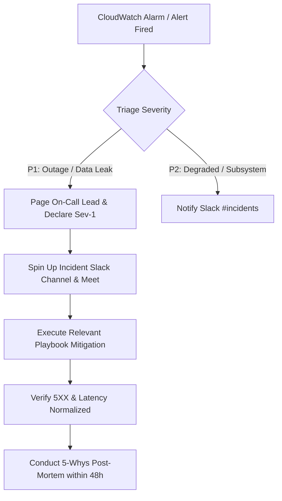

# Operational Runbooks & Incident Response Protocols

## 1. Playbook: High 5XX Error Rate Mitigation

### Symptom & Alarm
- **Alarm**: `${project_name}-${environment}-alb-5xx-error-rate-high` triggers (Target 5XX count > 5% for 10 minutes).
- **Severity**: P1 / Critical.

### Triage & Diagnostics
1. **Check CloudWatch Metrics**:
   - Inspect ALB dashboard for HTTP 502 (Bad Gateway) vs 504 (Gateway Timeout) vs 500 (Internal Server Error).
   - If 502/504: Containers are either terminating prematurely, failing health checks, or timing out.
   - If 500: Uncaught application runtime exceptions or unhandled database errors.
2. **Examine ECS Container Logs**:
   ```bash
   aws logs tail /ecs/beyourownboss-prod --since 15m --filter-pattern "ERROR"
   ```
3. **Verify Container Health Check**:
   ```bash
   aws ecs describe-services \
     --cluster beyourownboss-prod-cluster \
     --services beyourownboss-prod-service \
     --query "services[0].events[:5]"
   ```

### Mitigation Actions
- **If bad deployment**: Execute rollback command in `docs/deploy-aws.md` to previous task definition revision immediately.
- **If memory leak or OOM crash**: Scale task memory in task definition or temporarily bump task count:
  ```bash
  aws ecs update-service --cluster beyourownboss-prod-cluster --service beyourownboss-prod-service --desired-count 6
  ```
- **If dependent service failure (e.g., RDS)**: Follow Playbook 2 below.

---

## 2. Playbook: Database Connection Exhaustion

### Symptom & Alarm
- **Alarm**: `${project_name}-${environment}-rds-connections-high` triggers (Active connections > 80).
- **Impact**: Queries stall, transaction timeouts cascade into 504 Gateway errors.

### Triage & Diagnostics
1. Connect via administrative session and query active connections by database and state:
   ```sql
   SELECT pid, usename, client_addr, state, age(clock_timestamp(), query_start) AS duration, query
   FROM pg_stat_activity
   WHERE state != 'idle'
   ORDER BY duration DESC;
   ```
2. Identify whether long-running queries or connection pooling leaks are causing accumulation.

### Mitigation Actions
1. **Terminate Hanging Queries / Deadlocks**:
   ```sql
   SELECT pg_terminate_backend(pid)
   FROM pg_stat_activity
   WHERE duration > interval '3 minutes' AND state != 'idle';
   ```
2. **Restart ECS Tasks**:
   If connection pool state is orphaned across crashed container tasks:
   ```bash
   aws ecs update-service \
     --cluster beyourownboss-prod-cluster \
     --service beyourownboss-prod-service \
     --force-new-deployment
   ```
3. **Adjust Connection Pool Configuration**:
   Ensure Drizzle ORM client pool `max` connection limit per container task is bounded (`max: 15`).

---

## 3. Playbook: Tenant Suspension and Archival

### Trigger
Merchant non-payment, terms-of-service violation, or voluntary account closure.

### Procedure
1. **Set Tenant Status to Suspended via Admin API**:
   ```bash
   curl -X PATCH https://admin.byoboss.io/api/v1/admin/tenants/01J9X8T.../status \
     -H "Authorization: Bearer $PLATFORM_ADMIN_TOKEN" \
     -H "Content-Type: application/json" \
     -d '{"status":"suspended","reason":"TOS_VIOLATION"}'
   ```
2. **Immediate Effect**:
   - Edge Middleware detects `status: "suspended"` on lookup cache and immediately renders `403 Tenant Suspended` page for public storefront and admin access.
   - Active user sessions for that tenant are invalidated.
3. **Archival & Data Export (Optional)**:
   - Run tenant database export script to generate encrypted JSON backup of tenant catalog, orders, and assets.
   - Mark record `archived_at = NOW()`.

---

## 4. Playbook: Accidental Publish Rollback

### Trigger
Merchant published breaking storefront theme changes or erroneous pricing and requests emergency rollback to previous published version.

### Procedure
1. Query published page versions for the affected store:
   ```sql
   SELECT id, version_number, status, published_at
   FROM page_versions
   WHERE tenant_id = '01J9X8T...' AND page_id = '01J9X9P...'
   ORDER BY version_number DESC
   LIMIT 5;
   ```
2. Execute Rollback Mutation:
   ```sql
   -- Mark current version as rolled_back
   UPDATE page_versions SET status = 'superseded' WHERE id = 'current_bad_id';

   -- Promote previous good version to published
   UPDATE page_versions SET status = 'published', published_at = NOW() WHERE id = 'previous_good_id';
   ```
3. Invalidate Edge / CDN Cache:
   ```bash
   aws cloudfront create-invalidation \
     --distribution-id $DISTRIBUTION_ID \
     --paths "/stores/acme/*"
   ```

---

## 5. Playbook: Backup Verification & Point-in-Time Restore (PITR)

### Automated Retention
- RDS automated daily snapshots retained for 7 days.
- Point-in-Time Recovery (PITR) enabled up to the second within retention window.

### Recovery Procedure
1. **Restore to New Instance**:
   ```bash
   aws rds restore-db-instance-to-point-in-time \
     --source-db-instance-identifier beyourownboss-prod-db \
     --target-db-instance-identifier beyourownboss-prod-db-restored \
     --restore-time "2026-10-13T00:00:00Z" \
     --db-subnet-group-name beyourownboss-prod-db-subnet-group \
     --vpc-security-group-ids sg-rds-id
   ```
2. **Verify Restored Instance**:
   - Connect via test runner and verify row counts on `tenants`, `orders`, and `products`.
3. **Swap Connection Endpoint**:
   - Update `DATABASE_URL` secret in AWS Secrets Manager to point to the restored DB endpoint.
   - Force new ECS deployment to pick up new database instance.

---

## 6. Incident Response Protocol



### Communication Roles
- **Incident Commander (IC)**: Directs triage, playbook execution, and decisions.
- **Communications Lead (CL)**: Posts status updates to status page every 15 minutes.
- **Operations Lead (OL)**: Executes Terraform/AWS CLI actions and monitors log telemetry.
